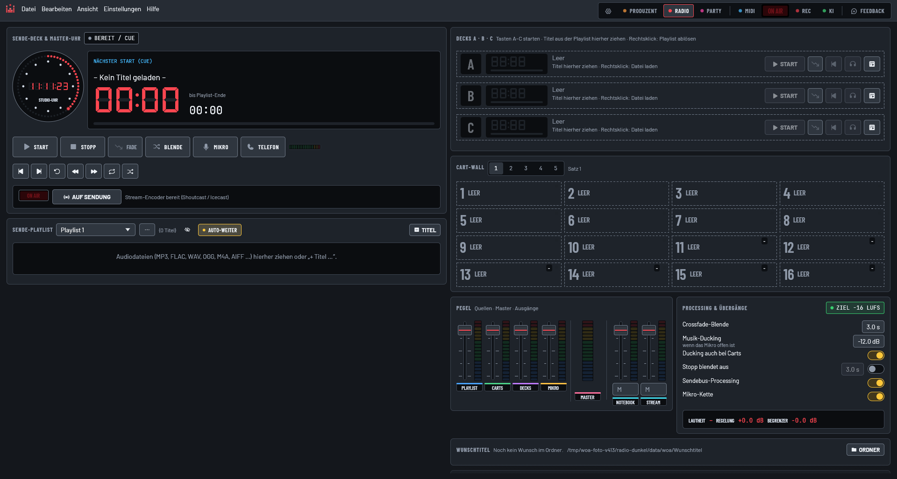
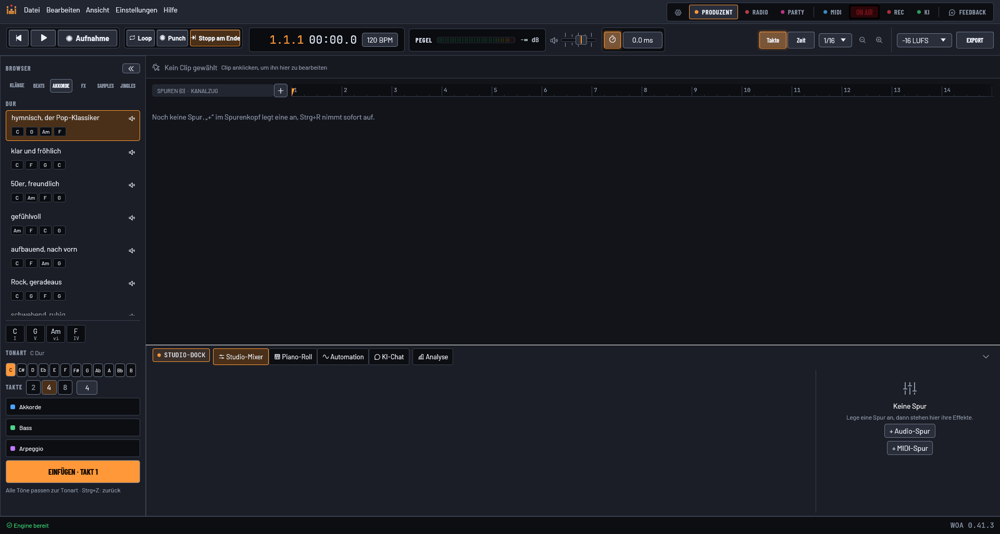
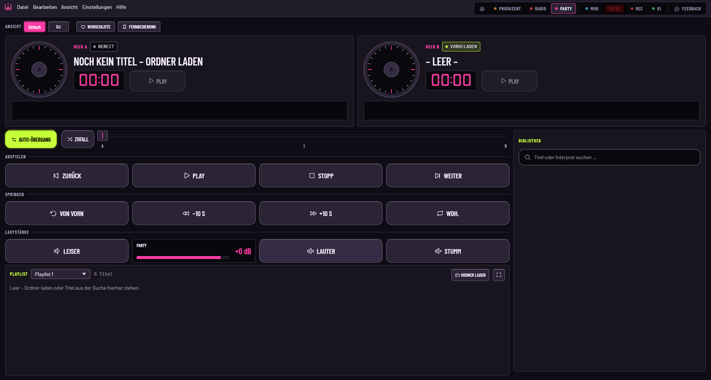
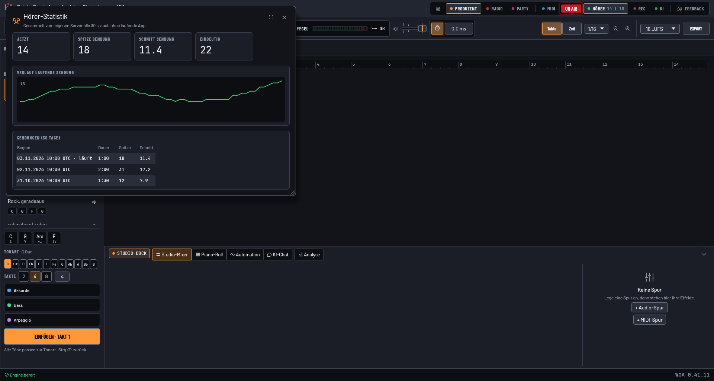

# WOA – Wir on Air

**Radio-Studio, DJ-Pult und Musikproduktion in einer App. Frei, offen, für Linux und Windows.**

WOA ist eine Digital Audio Workstation mit eingebautem Sendestudio. Du produzierst deinen Jingle,
legst ihn auf die Cartwall und gehst damit live – ohne zwischen drei Programmen zu wechseln.
Benannt nach dem Internetradio „raDio rEvoLuTiOn“ ([www.wir-on-air.de](https://www.wir-on-air.de),
auch unter wironair.de), das mit WOA sendet.

[**⬇ Neueste Version herunterladen**](https://github.com/nixblick/daw.woa/releases/latest) ·
Windows (MSI/ZIP) · Linux (AppImage/Flatpak) · eingebauter Updater mit signierten Updates ·
[Webseite](https://www.wir-on-air.de) · [Changelog](CHANGELOG.md)

<picture><source media="(prefers-color-scheme: light)" srcset="docs/design/ist/ist-0.41.3-radio-hell-1920x1030.png"></picture>

---

## Drei Modi, ein Programm

### 🎙 Radio – senden wie ein Profi
- **Sende-Deck mit Master-Uhr**, Playlist mit Lautheit je Titel und Restzeit bis Playlist-Ende
- **Decks A, B, C** und eine **Cartwall mit 16 Tasten** in fünf Sätzen, Vorhören per Knopf
- **Vorhören (PFL)** auf einem zweiten Gerät
- **Automatische Lautheit** auf -16 LUFS, Crossfade, **Musik-Ducking** beim Mikro, Fade-Taste
- **LED-Pegel** an jedem Fader und für das, was wirklich rausgeht
- **Pult-Modus**: die Sendung kommt vom externen Mischpult
- **Gäste per Browser-Link** ins Studio holen, mit Warteraum und Stummschalten
- **REC** schneidet die Sendung mit, egal in welchem Modus
- **Audio-Geräte an einem Ort**: Ausgänge, Vorhören, Mikrofon, Telefon und Pult-Eingang in einem Fenster

### 🎛 Produzent – Musik machen
- Audio- und MIDI-Spuren, Piano-Roll, Drum-Raster, Studio-Mixer, Automation, Busse
- Browser links mit Klängen, Beats, Akkordfolgen, FX, Samples (Freesound) und Jingles
- Assistent **„Jingle bauen“** mit Stimme, Ducking und Jingle-FX
- CLAP-Plugins, Aufnahme mit Latenzausgleich, Loop und Punch
- Export als Mixdown oder Stems, auf Wunsch gleich auf Sendelautheit

<picture><source media="(prefers-color-scheme: light)" srcset="docs/design/ist/ist-0.41.3-produzent-hell-1920x1030.png"></picture>

### 🪩 Party – auflegen
- Zwei Decks mit echtem Crossfader und **Auto-Übergang**
- **Wunschliste**: Gäste legen Titel in einen Ordner, WOA zeigt Interpret und Titel aus den Tags
- **Fernbedienung** übers Netz; Wunschliste und Fernbedienung lassen sich ausblenden

<picture><source media="(prefers-color-scheme: light)" srcset="docs/design/ist/ist-0.41.3-party-hell-1920x1030.png"></picture>

## Senden und Hörer

- **Streaming über `woa-streamd`**: ein eigener Sendedienst neben der Oberfläche schickt MP3 an
  deinen Shoutcast-Server. Stürzt die Oberfläche ab, sendet er weiter und spielt nach 2 s ohne Ton
  die Notfall-Playlist. Details: [`docs/stream.md`](docs/stream.md)
- **Titel für die Hörer**: WOA meldet den laufenden Titel per HTTPS an den eigenen Sendeserver,
  auch wenn Shoutcast nicht lokal läuft – ohne Kennwort in der URL.
- **Hörer-Statistik** (Ansicht › Hörer-Statistik): Hörer jetzt, Spitze und Schnitt der Sendung,
  Verlauf und die Sendungen der letzten 30 Tage; Hörerzahl auch oben in der Kopfleiste. Gesammelt
  wird auf dem eigenen Server, auch wenn die App nicht läuft.
- **Hörer-Seite** (`server/live/`): eine schlichte Seite zum Hören im Browser mit „Läuft gerade“,
  Hörerzahl und zuletzt gespielten Titeln – ohne Tracking, Cookies und externe Quellen.

<picture><source media="(prefers-color-scheme: light)" srcset="docs/design/ist/ist-hoerer-statistik-hell-1920x1030-0.41.11.png"></picture>

## KI, die mitarbeitet

- WOA spricht **MCP**. Verbinde Claude Desktop oder Claude Code mit der laufenden App, und die KI
  baut Beats, legt Spuren an und mischt – live im offenen Projekt. Details: [`docs/agent.md`](docs/agent.md)
- **Chat im Produzenten** mit Anthropic, OpenAI, OpenRouter oder lokal mit Ollama bzw. LM Studio
- **ElevenLabs** mit eigenem Schlüssel: Sprache für Jingles, Soundeffekte und Musikbetten, mit
  Kostenhinweis vor jeder Erzeugung. Der Schlüssel liegt nur im Schlüsselbund des Systems.
- Einrichtung: *Einstellungen → Dienste und Konten*, Anbieter wählen, fertig.

## Gebaut mit Sorgfalt

- **Rust** von vorn bis hinten, Audio-Pfad ohne Locks und ohne Speicherzuteilung
- Läuft auch auf **alten Laptops** – getestet auf einem rund 20 Jahre alten Windows-Rechner
- Einstellungen in einem Fenster (Strg+,) mit Suche, auch nach Umgangssprache
- Jede Änderung mit Tests, jede Version mit [Changelog](CHANGELOG.md)
- **Feedback direkt aus der App**, mit Screenshot und Protokoll – Wünsche landen oft am selben Tag
  in einer neuen Version

## Wer dahinter steht

WOA entsteht bei [**creaVisions**](https://www.creavisions.de), zusammen mit einem Team aus
KI-Mitarbeitern – schnell, getestet und offen. Von dort kommen auch die Schach-App
[bretteins](https://www.bretteins.de) und die Foto-Software [Main BilderSchatz](https://www.mainbilderschatz.de).

Du betreibst ein Webradio, brauchst eine Anpassung oder willst WOA in deinem Studio einsetzen?
Schreib über [creavisions.de](https://www.creavisions.de).

## Mitmachen

- Fehler und Wünsche: am liebsten über **Feedback** in der App, sonst als
  [Issue](https://github.com/nixblick/daw.woa/issues)
- Konzept: [`docs/konzept.md`](docs/konzept.md) · Senden: [`docs/stream.md`](docs/stream.md) ·
  KI/MCP: [`docs/agent.md`](docs/agent.md)
- Lizenz: **GPLv3**, siehe [`LICENSE`](LICENSE)

## Geheimnisse

Bisher keine. Vault: `~/.secrets/daw.woa/`.
